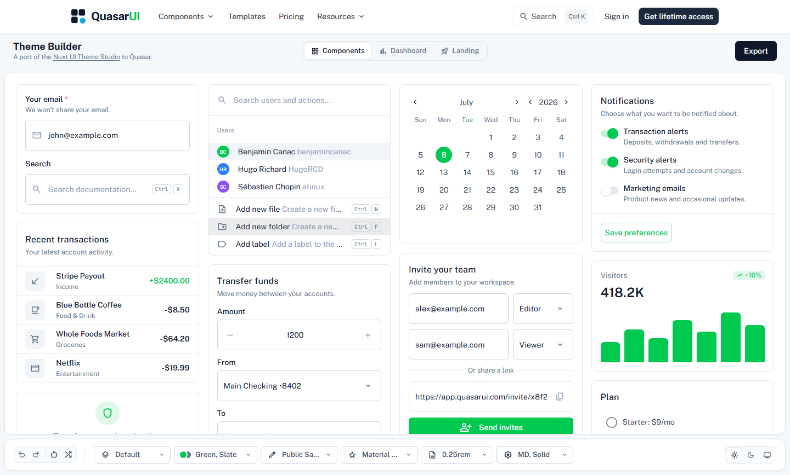
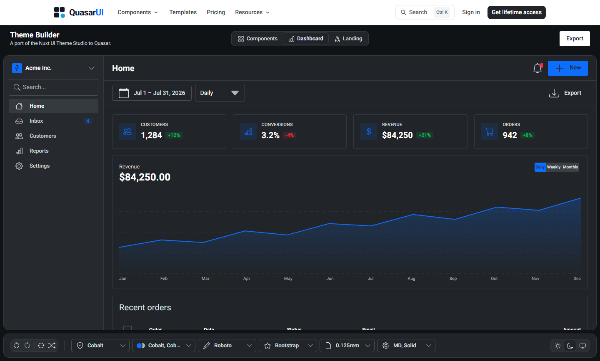
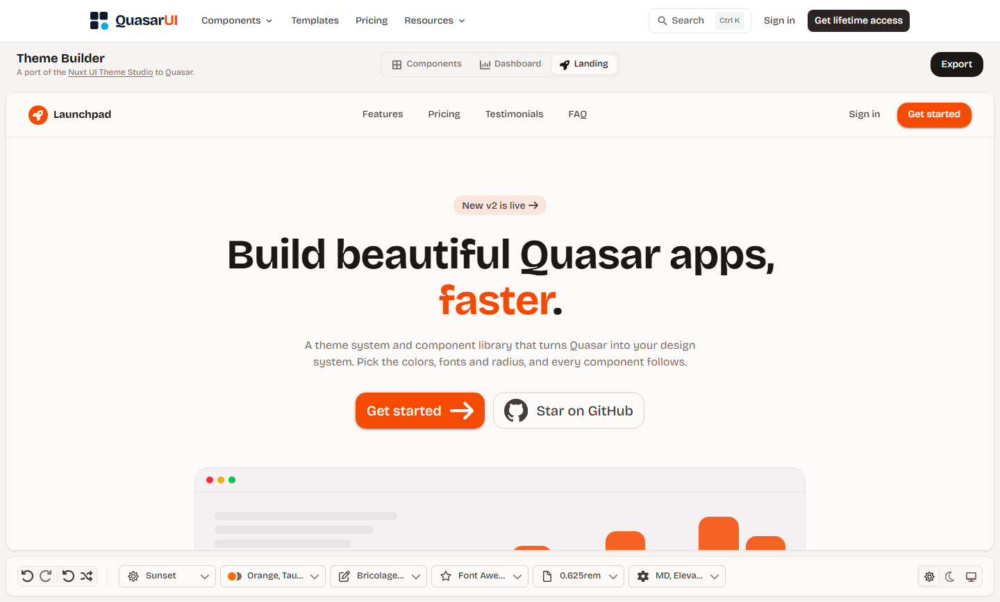
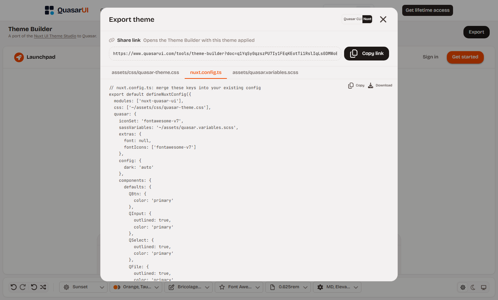

# Quasar Framework Theme Generator

Looking for a Quasar Framework Theme Generator? The free [Quasar Framework Theme Generator](https://www.quasarui.com/tools/theme-builder) on QuasarUI designs a complete theme for the [Quasar Framework](https://quasar.dev): pick a preset, build your Quasar color palette from a Tailwind palette or OKLCH curves, set fonts, icons, radius and component defaults, check the Quasar dark mode theme next to the light one on real components, then export ready-to-use files for Quasar CLI or Nuxt.

**[Open the Theme Generator →](https://www.quasarui.com/tools/theme-builder)**

> This repository is the landing page for the Theme Generator. The builder itself runs on [quasarui.com](https://www.quasarui.com/tools/theme-builder); there is no code to install here.

## Features

- **12 presets** to start from: Default, Mono, Cobalt, Sky, Mint, Iris, Crimson, Coral, Sunset, Carbon, Bubblegum and Parchment.
- **Brand colors and a neutral scale** for primary, secondary, accent, positive, negative, info and warning, taken from a Tailwind palette, set shade by shade, or shaped with OKLCH curves.
- **Light and dark mode**, each with its own surface, text and border tokens. Preview either one, or follow the system setting.
- **Fonts** for body, headings and code, with size, letter spacing, line height and weights.
- **12 icon sets**, including Material Symbols, Material Icons, Material Design Icons, Font Awesome, Bootstrap Icons and Ionicons.
- **Radius and component defaults**: size, plus button, card and input variants.
- **Live preview** on three views: Components, Dashboard and Landing.
- **Undo and redo, random theme and reset.**
- **Share link** that opens the Theme Generator with your theme applied.
- **Export** for Quasar CLI or Nuxt, ready to copy or download.

| Dashboard view, Cobalt preset, dark mode | Landing view, Sunset preset |
| --- | --- |
|  |  |

## Use an exported theme

Click **Export** in the Theme Generator and pick your project type. Full steps are in the [QuasarUI theming docs](https://www.quasarui.com/documentation/theming).

### Quasar CLI

1. Save `src/css/quasar-theme.css`, `src/boot/theme-defaults.js` and `src/css/quasar.variables.scss` into your project.
2. Merge the keys from the exported `quasar.config.js` (`boot`, `css`, `extras` and `framework`) into your own `quasar.config.js`.

### Nuxt (nuxt-quasar-ui)

1. Save `assets/css/quasar-theme.css` and `assets/quasar.variables.scss` into your project.
2. Merge the keys from the exported `nuxt.config.ts` (`modules`, `css` and `quasar`) into your own config.
3. Install `sass` for the Sass variables: `npm install -D sass`.

The CSS file owns dark mode, so keep `dark: "auto"` (or your own toggle) in the Quasar config.

## Credits

The Theme Generator is a port of the [Nuxt UI Theme Studio](https://ui.nuxt.com/theme) to Quasar. Its palette engine, curve editor and preset designs are adapted from Nuxt UI (MIT).

Made by [QuasarUI](https://www.quasarui.com): Quasar components, blocks and templates for Vue and Nuxt.

## License

[MIT](LICENSE)
